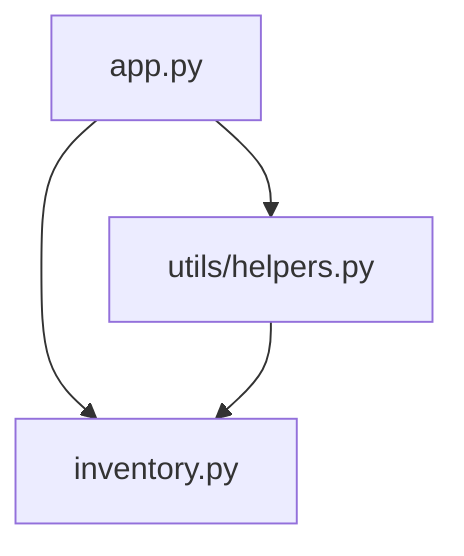

## Functions and Classes (from the Lab 3 inventory project)
- inventory.py: Item class
- utils/helpers.py: item_value(), total_stock_value(), highest_stock_item(), lowest_stock_item()
- app.py: print_report(), main()

## Code Smells
1. Data doesn't survive a restart, the inventory list is only in memory.
2. utils/helpers.py holds business logic despite its name suggesting small utility functions.